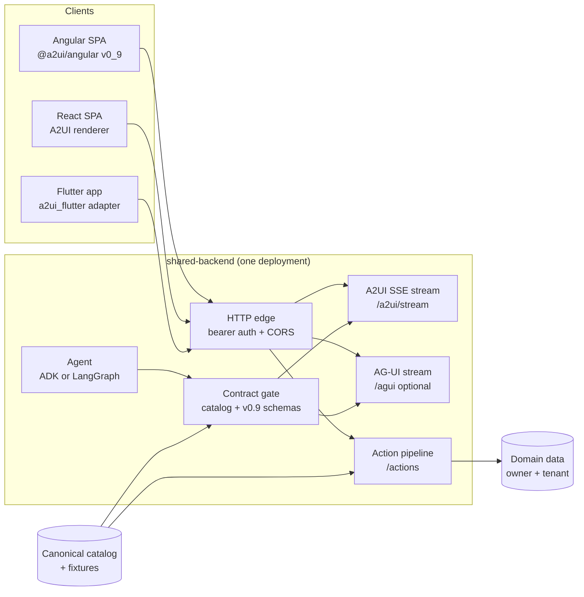
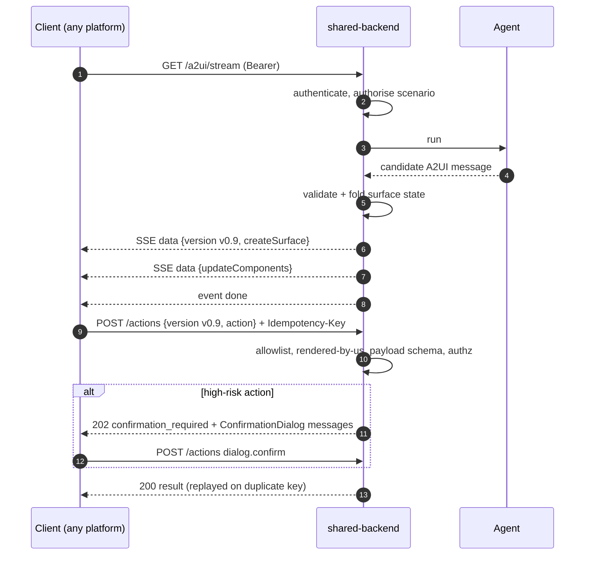
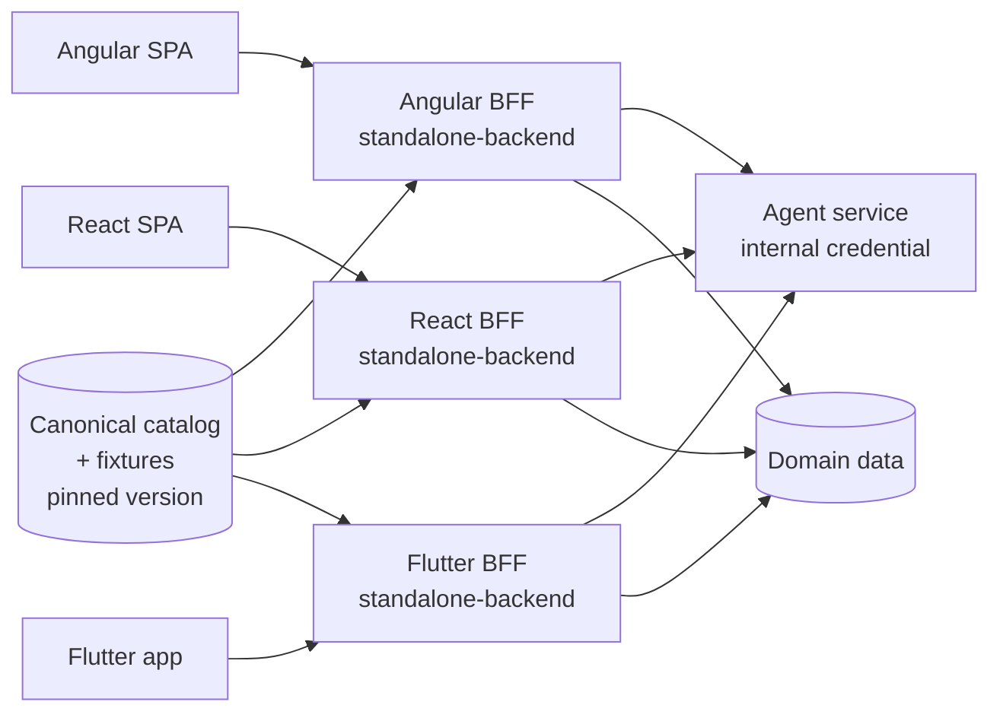
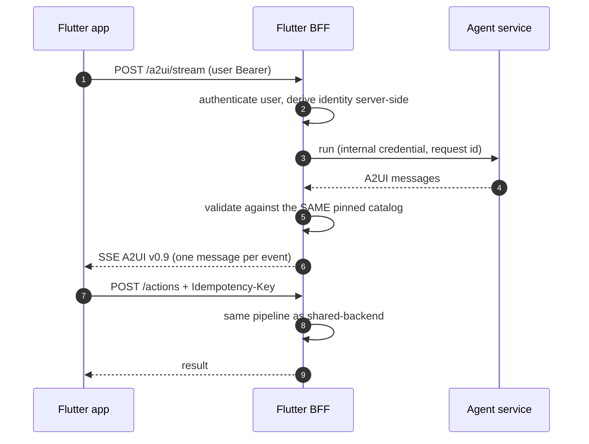

# Backend topologies: `shared-backend` vs `standalone-backend`

Every platform renders the same canonical catalog ([canonical-catalog.json](canonical-catalog.json)). What changes between topologies is who owns the server that streams A2UI v0.9 messages and receives actions. The catalog, fixtures and action rules stay the same in both.

Evidence: both topologies are built from one reference app (FastAPI 0.165.0, sse-starlette 3.7.1, ag-ui-protocol 1.0.0, Python 3.14), started with `--mode shared` or `--mode standalone --client angular|react|flutter`. That app has 60 pytest tests, all passing, and the same tests pass in both modes. **DOCUMENTED AND TESTED** for the behaviour described here. The diagrams are **RECOMMENDED PRACTICE**.

## When to choose which

| Question | `shared-backend` | `standalone-backend` |
|---|---|---|
| Who owns the agent? | One team runs one agent service for every client | Each client team runs its own BFF (backend for frontend) that calls the agent, or embeds one |
| Release coupling | Every client gets the new behaviour at the same time; catalog changes need all renderers ready first | Each BFF ships on its own schedule; the catalog version is pinned per BFF |
| Per-client logic | Kept small: capability negotiation only | Allowed in the BFF (layout choice, per-platform feature flags) |
| Ops cost | 1 deployment, 1 set of credentials, 1 audit trail | N deployments, and N places that must enforce the same rules |
| Choose when | One product with web and mobile clients, and one agent team | Clients belong to separate products or teams, or one client needs an extra server-side integration |

Default to `shared-backend`. Move to `standalone-backend` only when one of the reasons in the last row applies. Each standalone BFF must repeat every rule in [action-security.md](action-security.md). It is a copy of the server rules, not a lighter version of them.

## What is shared and what is not

| Shared in both topologies (a contract; a change goes through a catalog version bump) | Not shared |
|---|---|
| Catalog: component IDs, props, `x-genui` limits and forbidden patterns | Layout and widget code (Angular components, React components, Flutter widgets) |
| Action allowlist and every `payloadSchema` | Styling and theme beyond the catalog `theme` |
| Surface IDs and data-model shapes used in fixtures | Client state management (signals, TanStack Query, Riverpod) |
| Golden action payloads (`fixtures/actions/`) | Transport client library (EventSource, fetch, `package:http`) |
| Authorization expectations: who may act on which resource, and the 401/403/404/409 codes | Server framework (FastAPI, NestJS, Spring) when each BFF is separate |
| Contract tests: every server runs every fixture; every client replays the same fixtures | |

## Rules that hold in both

1. **Credentials never reach a client.** Model keys, agent service credentials and database credentials stay in the server process, loaded from the environment or a secret manager. Clients hold only the user's own session or bearer token.
2. **The server validates before it streams.** Each A2UI message passes `Contract.validate_server_message` (version, wire schema, catalog, forbidden patterns, depth). Each surface passes the graph check (root, dangling references, cycles) before the first byte leaves the server. See [backend-emitters.md](backend-emitters.md).
3. **The server authorises every action.** It uses the authenticated principal, never the action `context` ([action-security.md](action-security.md)).
4. **One wire version.** Messages carry `"version": "v0.9"`. Anything else is rejected with `UNSUPPORTED_VERSION`, never parsed best-effort.

## `shared-backend` architecture





## `standalone-backend` architecture





A BFF passes frames through as bytes once they are validated. If the upstream connection, a read or a status check fails, the BFF sends one terminal `error` frame. This follows rule 11 in [server-stream-lifecycle.md](../../streaming-protocols/reference/server-stream-lifecycle.md).

## Running both topologies locally

```bash
export GENUI_DEMO_TOKEN_USER_A=<random-16+>   # from your shell, never committed
export GENUI_DEMO_TOKEN_USER_B=<random-16+>
uv run python -m genui_backend --mode shared                      # :8710, CORS for :4200 and :5173
uv run python -m genui_backend --mode standalone --client angular # :8711, CORS for :4200 only
uv run python -m genui_backend --mode standalone --client flutter # :8713, no CORS (native client)
```

`--mode standalone` without `--client` exits with code 2. Every response carries `X-GenUI-Topology` (`shared-backend` or `standalone-backend; client=<name>`), so a parity test can confirm which server it reached. A missing demo-token variable stops startup (fail closed). A fixture that fails the contract also stops startup.

## Contract tests every topology runs

| Test | Expectation |
|---|---|
| Every `fixtures/valid/*.json` | Streams unchanged and ends with `done` |
| Every `fixtures/invalid/*.json` | Rejected with its `expectedError` code (all 20 match in the reference app) |
| Every golden `fixtures/actions/*.json` | Accepted after its fixture surface is rendered to the same user |
| Wrong version, unknown action, other user's resource, other tenant's resource, duplicate key, cancel, reconnect | 400 / 400 / 403 / 404 / replay / generation stops / resume or re-sync |
