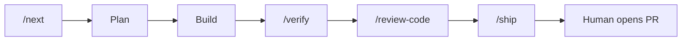

# Claude Code Onboarding Kit

[](https://docs.anthropic.com/en/docs/claude-code)
[](https://deepwiki.com/kumaran-is/claude-code-onboarding)
[](LICENSE)


**Get a team from zero to productive with Claude Code in under 30 minutes.**

This is a pre-configured Claude Code toolkit: skills, agents, slash commands, hooks, and MCP integrations for the stacks we actually ship. Versions match `CLAUDE.md`.

| Layer | Technologies |
|---|---|
| **Backend** | Java 25 LTS, Spring Boot 4.2.x (Spring Framework 7.1; MVC default, WebFlux when justified), Node.js 26.13.x, NestJS 12.6.x, Fastify, Prisma 7, Python 3.14, FastAPI 0.165.x, TypeScript 6.0.x |
| **Agentic AI** | LangChain 1.5.2, LangGraph 1.2.24, Google ADK 2.15.1, FastAPI 0.165.0 |
| **Frontend** | Angular 22.3.x, TypeScript 6.0.x, Tailwind CSS 4.3.5, React 19.3 + Vite 8 (optional), A2UI 1.0 |
| **Mobile** | Flutter 3.50.x, Dart 3.14.0 |
| **Data & infra** | PostgreSQL 18 + pgvector 0.8, Weaviate, Firebase, Docker |

Clone it, install Claude Code, run `/next`.


## Contents

- [Why this toolkit](#why-this-toolkit)
- [Getting started](#getting-started)
  - [Prerequisites](#prerequisites)
  - [Clone this repo](#clone-this-repo)
  - [Set up your editor](#set-up-your-editor)
  - [Install Claude Code](#install-claude-code)
  - [First run](#first-run)
  - [Optional: memory and voice](#optional-memory-and-voice)
  - [First five minutes](#first-five-minutes)
- [Engineering workflow](#engineering-workflow)
- [Key commands](#key-commands)
- [Polyglot monorepo (native-only, Melos-only, Nx-only, Nx + Melos)](#polyglot-monorepo-native-only-melos-only-nx-only-nx--melos)
- [What's included](#whats-included)
- [Security and quality](#security-and-quality)
- [Optional AWS AI-DLC](#optional-aws-ai-dlc)
- [Customize, docs, and contributing](#customize-docs-and-contributing)
- [Troubleshooting](#troubleshooting)
- [Resources](#resources)

## Why this toolkit

- **`/next` engineering loop** — pick the next GitHub issue or local plan, implement, verify, review, and stop at a human merge gate.
- **Stack specialists** — skills and agents for Java, NestJS, Python, Angular, React, and Flutter, routed from [`.claude/SKILLS_GUIDE.md`](.claude/SKILLS_GUIDE.md).
- **Evidence over claims** — `/verify` and `/ship` are binary PASS/FAIL; independent reviewers do not implement the change.
- **Guardrails** — hooks catch common destructive commands and secret edits; git refuses secret-bearing commits. They are not an absolute security boundary.

[Changelog](CHANGELOG.md) · [Notes](docs/articles.md) · [Full docs](docs/README.md) · [Official Claude Code](https://code.claude.com/docs/en/overview)

## Getting started

### Prerequisites

- A **Claude Pro, Max, Ultra, Team, or Enterprise** subscription at [claude.ai](https://claude.ai), or an Anthropic API key from the [Console](https://console.anthropic.com)

Optional for MCP servers and this kit's stacks: [Node.js 26.13.x LTS](https://nodejs.org/en/download) and [Python 3.14+](https://www.python.org/downloads/).

### Clone this repo

**Option A — learn here (recommended first)**

```bash
git clone https://github.com/kumaran-is/claude-code-onboarding.git
cd claude-code-onboarding
chmod +x .claude/hooks/*.sh
cp git-hooks/pre-commit-secrets.sh .git/hooks/pre-commit
chmod +x .git/hooks/pre-commit
```

**Option B — add to an existing project (merge, do not overwrite)**

Do **not** `cp -r` the kit onto a project that already has `.claude/`, `CLAUDE.md`, or `.mcp.json`. Back those up, copy only missing kit files, and merge the rest by hand.

```bash
stamp=$(date +%Y%m%d)
dest="$HOME/claude-kit-backup-$stamp"
mkdir -p "$dest"
[ -d your-project/.claude ] && cp -R your-project/.claude "$dest/claude"
[ -f your-project/CLAUDE.md ] && cp your-project/CLAUDE.md "$dest/"
[ -f your-project/.mcp.json ] && cp your-project/.mcp.json "$dest/"
[ -f your-project/.git/hooks/pre-commit ] && cp your-project/.git/hooks/pre-commit "$dest/"

mkdir -p your-project/.claude
for d in skills agents commands hooks rules scripts; do
  mkdir -p "your-project/.claude/$d"
  cp -Rn "claude-code-onboarding/.claude/$d/." "your-project/.claude/$d/"
done
chmod +x your-project/.claude/hooks/*.sh
[ -f your-project/.claude/settings.json ] || cp claude-code-onboarding/.claude/settings.json your-project/.claude/
```

Diff and merge `CLAUDE.md`, `.mcp.json`, and `.claude/settings.json` yourself — do not replace live copies with the kit files. Hooks only run if `settings.json` registers them; merge those entries if the file already exists. Keep only the MCP servers you need (`${ENV_VAR}` tokens). If `.git/hooks/pre-commit` already exists, chain the secrets scan; otherwise:

```bash
cp claude-code-onboarding/git-hooks/pre-commit-secrets.sh your-project/.git/hooks/pre-commit
chmod +x your-project/.git/hooks/pre-commit
```

Then trim unused skills/agents/commands. This kit's committed `.claude/settings.json` sets `permissions.defaultMode` to `auto` with **no allow/deny lists**. Put personal allow rules in `.claude/settings.local.json` (gitignored).

### Set up your editor

[VS Code](https://code.visualstudio.com/) is recommended. Claude Code runs from any terminal. Open this repo and use the integrated terminal for the rest of setup.

### Install Claude Code

Native binary (macOS / Linux), from the [official quickstart](https://code.claude.com/docs/en/quickstart):

```bash
curl -fsSL https://claude.ai/install.sh | bash
source ~/.zshrc   # or ~/.bashrc
claude --version
```

Restart the terminal (or VS Code) if `claude` is not on `PATH`. Windows: follow the same official quickstart.

### First run

```bash
claude
```

Authenticate when prompted. The session loads `CLAUDE.md`, `.mcp.json`, and `.claude/`.

```
> /project-status
> What agents and skills are available in this project?
> Explain the tech stack from CLAUDE.md
```

### Optional: memory and voice

**Claude-Mem** — persistent memory across sessions. Inside Claude Code:

```
> /plugin marketplace add thedotmack/claude-mem
> /plugin install claude-mem
```

Restart the session. Full team-sharing setup: [docs/getting-started/claude-mem.md](docs/getting-started/claude-mem.md).

**Voice Mode** — talk instead of type. Paste the setup prompt from [docs/getting-started/voice-mode.md](docs/getting-started/voice-mode.md), then restart Claude Code and run `claude converse`.

### First five minutes

```
> What is this project? Summarize the tech stack and structure
> /project-status
> /new-project python REST API for invoices
> @architect What improvements would you suggest for this project's structure?
> Explain Spring Security JWT. use context7
> /mcp
```

`/new-project` routes a description to the matching scaffold (Spring, NestJS, Python, Angular, Flutter, and related). Append `use context7` when you need live docs instead of training data.

Claude Code may still ask about some tools. This kit uses `auto` mode plus hooks — not `--dangerously-skip-permissions`. On a real project, add frequent tools to `.claude/settings.local.json`.

## Engineering workflow

The differentiator is `/next`: pick work, implement it, prove it, review it, then stop for a human to open the PR and merge.



| Step | What happens |
|---|---|
| **Pick** | `/next` reads GitHub issues/projects, local `docs/plans/`, and in-flight branches. It does not implement until the full issue or plan is read. `/next --plan` waits for your approval. |
| **Build** | Stack skills and agents write the change. `/next --fix-loop` is opt-in after a failing `/verify` (bounded Ralph retry, never the next issue). |
| **Verify** | `/verify` runs impact-aware compile/lint/tests. `/verify quick` is not PR evidence. `/verify pre-pr` runs on a frozen tree. |
| **Review** | `/review-code` dispatches independent reviewers. The implementer is not the approver. |
| **Ship** | `/ship` is a **readiness** report. It does not merge. `/create-pr` prints `gh pr create`; you run it. Merge is a human keyword. |

Default `/next` is human-in-the-loop. **`/next --auto` is experimental** — opt-in exact flag, explicit scope required — until the live GitHub PR/CI/merge path is validated. Natural language never enables `--auto`. Neither `/next` nor `/aidlc` starts the other.

## Key commands

| Command | Purpose |
|---|---|
| `/next` | Pick and implement the next actionable item |
| `/next --auto` | **Experimental.** Multi-story coordinator; exact flag only |
| `/verify` | Binary build + test for stacks the diff can reach |
| `/review-code` | Independent multi-agent review |
| `/ship` | Pre-deploy readiness. Does not merge |
| `/new-project` | Route a description to the right scaffold |
| `/setup-aidlc` | Plan and (after approval) install official AWS AI-DLC |

Catalog and stack routing: [`.claude/SKILLS_GUIDE.md`](.claude/SKILLS_GUIDE.md). Practice prompts: [hands-on exercises](docs/examples/hands-on-exercises.md).

## Polyglot monorepo (native-only, Melos-only, Nx-only, Nx + Melos)

Package managers stay **language-native**. Orchestration is a separate, **approved** choice. Spec: [MONO-ARCH-001](docs/Nx_Melos_Polyglot_Monorepo_Architecture_Spec.md). This kit does **not** add Nx by default and does **not** ship Melos or Nx MCP.

Ask to design the workspace, run `/new-project` with `monorepo`, or `/design-architecture`. Claude loads [`polyglot-monorepo`](.claude/skills/polyglot-monorepo/SKILL.md), recommends one mode, and **stops for your approval** before `nx init`.

```bash
python3 .claude/skills/polyglot-monorepo/scripts/discover_monorepo.py --root .
python3 .claude/skills/polyglot-monorepo/scripts/audit_monorepo_graph.py --root . --expect expect.json
```

| Mode | When | Tools |
|---|---|---|
| **NATIVE ONLY** | Small/simple repo | pub / uv / npm / Gradle or Maven + Makefile |
| **MELOS ONLY** | Flutter/Dart multi-package | Dart `workspace:` + Melos 8.x (kit pin 8.10.1). No `melos.yaml`. |
| **NX ONLY** | Angular/React/Node/Java, optional Python, **if justified** | pnpm/npm + Nx; Gradle via `@nx/gradle` when compatible; Python via explicit edges + `uv run` |
| **NX + MELOS** | Flutter **plus** substantial JS/Java/Python, **if justified** | One Flutter Nx bridge; Melos owns Dart tests; Nx owns the rest |

Scaffolds (`/scaffold-flutter-app`, `/scaffold-python-api`, `/scaffold-angular-app`, `/scaffold-spring-api`, `/scaffold-mcp-server`) join an existing language workspace. There is no `/scaffold-monorepo`. Do not `melos version` independently shipped apps. Never cache `deploy` / `migrate` / `release` / `docker-push` or unverified generated code. Git `base` comes from the repo, not an assumed `main`. If `git_baseline` is unresolved, do not enable affected-only CI. Enable Nx MCP only in a product repo that already has `nx.json` — [nx-and-mcp.md](.claude/skills/polyglot-monorepo/reference/nx-and-mcp.md).

Docs: [Melos](https://melos.invertase.dev/) · [uv workspaces](https://docs.astral.sh/uv/concepts/projects/workspaces/) · [npm workspaces](https://docs.npmjs.com/cli/using-npm/workspaces) · [Nx multi-language](https://nx.dev/docs/features/multi-language-support) · [Nx affected](https://nx.dev/docs/features/ci-features/affected)

## What's included

```
claude-code-onboarding/
├── .claude/
│   ├── agents/
│   ├── commands/
│   ├── skills/
│   ├── rules/
│   ├── hooks/
│   ├── scripts/
│   └── settings.json
├── .github/
├── docs/
├── git-hooks/
├── img/
├── CLAUDE.md
├── .mcp.json
├── LICENSE
└── README.md
```

| Folder | Purpose |
|---|---|
| `.claude/` | Claude Code configuration, agents, skills, commands, rules, hooks, and scripts |
| `.github/` | Toolkit CI (lint, doc refs, context-budget canaries) |
| `docs/` | Guides and examples moved off this page |
| `git-hooks/` | Commit-time secret scan (copy into `.git/hooks/pre-commit`) |
| `img/` | README images |
| `CLAUDE.md` | Project instructions and engineering conventions |
| `.mcp.json` | MCP server connections (tokens via `${ENV_VAR}` only) |

| Component | Role |
|---|---|
| **Skills** | Domain knowledge Claude loads when the task matches |
| **Commands** | `/` shortcuts you invoke |
| **Agents** | Specialists with isolated context (`@name` or auto) |
| **Hooks** | Deterministic PreToolUse / Stop / PreCompact guardrails |
| **MCP** | External tools (docs, GitHub, databases, Flutter) |

Do not inventory every file here — counts rot. Use [`.claude/SKILLS_GUIDE.md`](.claude/SKILLS_GUIDE.md).

## Security and quality

- Prompts, `@file` contents, and tool output go to Anthropic's API. Never paste live secrets.
- `.mcp.json` must use `${ENV_VAR}` references, never hardcoded tokens.
- Committed `settings.json`: `model: sonnet`, `permissions.defaultMode: auto`, **no** allow/deny lists.
- Hooks are **guardrails, not a security boundary**. They block common `rm -rf`, force-push to main, `DROP DATABASE`, piping curl to a shell, and **Write/Edit** of `.env`, keys, and lockfiles. Wrappers such as `bash -c`, `env`, `time`, and `pnpm exec` can skip some `nx init` / raw-scaffold checks. `CC_NX_INIT=1` is a transcript marker, not a cryptographic gate.
- Update lockfiles with the package manager in Bash (`npm install`, `uv lock`, `flutter pub get`). Hooks block Claude from **Write/Edit** of those files so they are not hand-edited; they do not block legitimate package-manager updates.
- Install the git secrets hook after clone (`git-hooks/pre-commit-secrets.sh`). Never `--no-verify` around it.
- `/verify` and `/ship` require executed evidence. Independent review is required before READY.
- `/next --auto` still cannot self-approve, `--force` merge, or skip the human for production secrets.
- Do **not** use `--dangerously-skip-permissions` on real projects, CI, or shared machines.

Details and checklist: [docs/security.md](docs/security.md).

## Optional AWS AI-DLC

[AWS AI-DLC](https://github.com/awslabs/aidlc-workflows) is a separate upstream product. This repo does not copy or fork its engine.

`/setup-aidlc` discovers the project, checks compatibility with this toolkit, prints an install plan, and waits for **human approval**. It then uses the official native `aidlc` CLI (`aidlc config --harness claude`, `aidlc doctor`). Latest stable is discovered at run time — it is not hardcoded.

| Command | Owner |
|---|---|
| `/next`, `/verify`, `/ship`, Ralph, SDD | this toolkit |
| `/aidlc` after setup | AWS AI-DLC |

They coexist. Neither starts the other. If official config would overwrite toolkit files, setup stops. Pin, upgrade, and doctor flags: `/setup-aidlc --pin X.Y.Z`, `--upgrade`, `--doctor`.

## Customize, docs, and contributing

Five steps:

1. Rewrite `CLAUDE.md` for your product and stack.
2. Delete unused folders under `.claude/skills/`, `.claude/agents/`, and `.claude/commands/`.
3. Keep always-loaded rules lean; add team rules as new files under `.claude/rules/`.
4. Edit `.mcp.json` — remove servers you do not use.
5. Add agents, commands, skills, or hooks with the templates in [docs/engineering/customizing.md](docs/engineering/customizing.md).

More: [docs/README.md](docs/README.md) (CI/CD, Terraform, iOS/Android release, troubleshooting).

Contributions: PRs against `develop`, conventional commits (`feat:`, `fix:`, `docs:`), squash merge. Never commit secrets. Do not weaken quality gates or expand always-loaded context without measuring `bash .claude/scripts/check-context-budget.sh --strict`.

## Troubleshooting

**`command not found: claude`**

```bash
echo 'export PATH="$HOME/.local/bin:$PATH"' >> ~/.zshrc
source ~/.zshrc
```

**MCP server not connecting** — run `/mcp`. Confirm Node.js/`npx`, set tokens as environment variables, restart Claude Code after editing `.mcp.json`.

**Skills or agents ignored** — confirm files exist under `.claude/skills/` and `.claude/agents/` with valid YAML frontmatter. Name the skill explicitly if needed.

More (Windows/WSL, `claude doctor`): [docs/troubleshooting.md](docs/troubleshooting.md).

## Resources

| Resource | Link |
|---|---|
| Claude Code docs | [code.claude.com/docs](https://code.claude.com/docs) |
| Quickstart | [code.claude.com/docs/en/quickstart](https://code.claude.com/docs/en/quickstart) |
| Settings, skills, hooks, MCP | [settings](https://code.claude.com/docs/en/settings) · [skills](https://code.claude.com/docs/en/skills) · [hooks](https://code.claude.com/docs/en/hooks) · [MCP](https://code.claude.com/docs/en/mcp) |
| AWS AI-DLC | [awslabs/aidlc-workflows](https://github.com/awslabs/aidlc-workflows) |
| This kit's catalog | [`.claude/SKILLS_GUIDE.md`](.claude/SKILLS_GUIDE.md) |
| Detailed guides | [docs/README.md](docs/README.md) |
